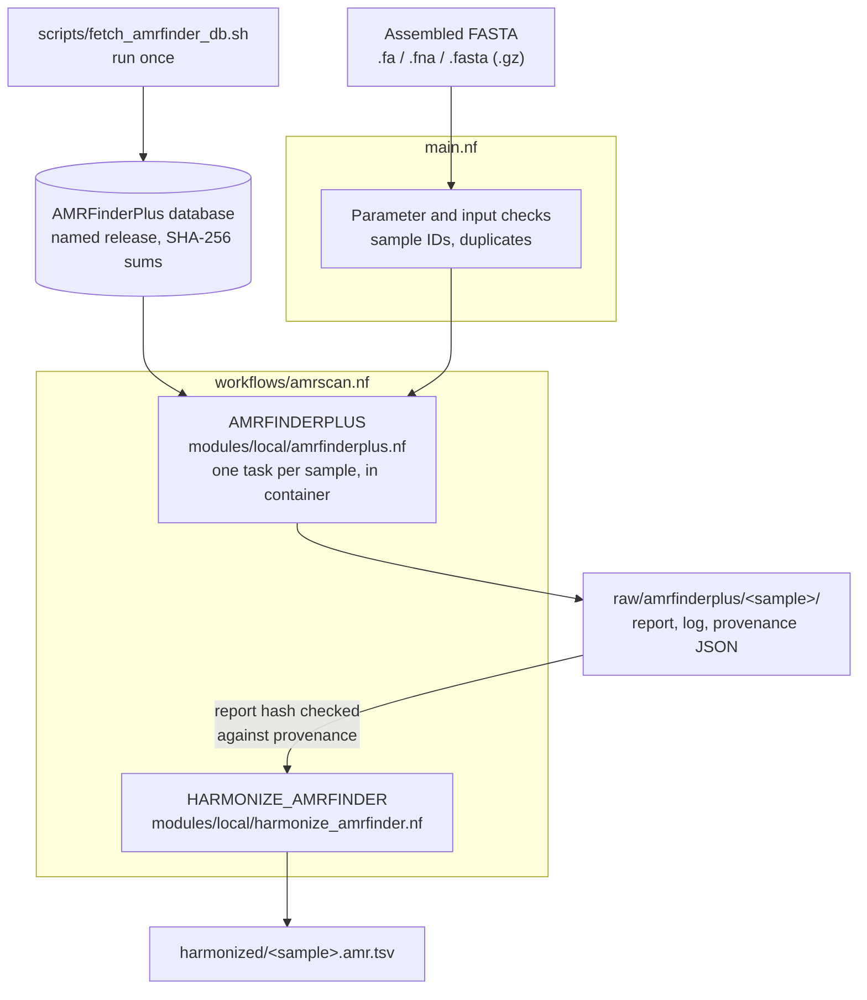

# AMRScan

AMRScan calls antimicrobial resistance (AMR) genes and point mutations in
bacterial genome assemblies with NCBI AMRFinderPlus, inside a Nextflow workflow
that records the software, database and input hashes of every run and
harmonizes the calls into one table. A second tool archives public
antimicrobial susceptibility testing (AST) data from NCBI Pathogen Detection,
so that every phenotype can be traced back to its source export and genome.

The workflow follows nf-core conventions and has been run on 1,000 public
*E. coli* assemblies on NCI Gadi, with every report byte-identical to an earlier
run of the same files on another platform
([record](docs/gadi-scale-run.md)). [Contributing to
nf-core](#contributing-to-nf-core) gives the plan to upstream parts of it.

Together they are the data layer of a larger study of genomic AMR prediction in
*Escherichia coli*: 10,521 public genome-sequenced isolates with 162,629
susceptibility results from 26 countries, collected 2009–2025, each genome
called with the same pinned AMRFinderPlus release. The study asks how well
resistance predicted from the genome carries over to lineages, countries,
submitting projects and years that were not in training, and which resistance
mechanisms account for the cases where it does not. The cohort build,
population structure, determinant baseline, generalisation benchmark across 24
drugs and six split designs, and the error analysis are being prepared for
publication and will be released here with the manuscript.
The study is my own work: the analysis is complete and the manuscript is in
preparation. The full analysis code and results are in a private repository,
available to reviewers and prospective employers on request.

A sequence match does not by itself establish phenotypic resistance. A negative
report also does not establish susceptibility. Retain caller methods, database
snapshots, thresholds, and the original report when interpreting results.

## Project links

- [Source repository](https://github.com/taowis/amrscan)
- [Documentation and workshop](https://taowis.github.io/amrscan/)
- [Preprint describing version 1](https://arxiv.org/abs/2507.08062)

## Version 2 and version 1

Version 1 (2025, described in the preprint) was a small BLAST search against
CARD, written once as an R script and once as a single Nextflow file. Version 2
is a rewrite. The version 1 code is kept unchanged under [`legacy/`](legacy/)
so the preprint can still be reproduced.

| | Version 1 (`legacy/`) | Version 2 (this README) |
| --- | --- | --- |
| Caller | BLAST against CARD protein homologs | NCBI AMRFinderPlus 4.2.7, genes and point mutations |
| Workflow | One Nextflow file and one R script | DSL2 entry point, subworkflow and modules |
| Software | BLAST and R installed by hand | Docker, Apptainer/Singularity and Conda profiles from one pinned specification |
| Database | CARD file downloaded by hand | Versioned release fetched once, indexed and hashed |
| Provenance | None | Command, versions and input, database and report hashes for every sample |
| Output | Top-hit summary CSV | Original report plus a harmonized TSV with a fixed schema |
| Tests | Manual demonstration | Python unit tests (90% branch coverage floor), nf-test, GitHub Actions CI |
| Documentation | README and R Markdown | Workshop site with exercises, Gadi notes and troubleshooting |

Where the code is:

| Path | What it does |
| --- | --- |
| [`main.nf`](main.nf) | Entry point: parameter and input checks |
| [`workflows/amrscan.nf`](workflows/amrscan.nf) | Joins the caller and harmonization steps |
| [`modules/local/`](modules/local/) | DSL2 processes for AMRFinderPlus and harmonization |
| [`bin/amrscan.py`](bin/amrscan.py) | Caller wrapper, provenance record and harmonizer used by the modules ([why](docs/decisions/0006-caller-wrapper.md)) |
| [`conf/`](conf/) | Resource defaults, `test` profile and NCI Gadi profile |
| [`tests/`](tests/) | Python tests, nf-test cases and fixtures |
| [`docs/tutorial/`](docs/tutorial/) | Workshop source |

## Modular workflow



Both processes run [`bin/amrscan.py`](bin/amrscan.py) inside the pinned container
([why](docs/decisions/0006-caller-wrapper.md)).

Use assembled nucleotide FASTA (`.fa`, `.fna`, `.fasta`, optionally `.gz`). Raw
FASTQ, protein/GFF combined searches and per-sample organism metadata are not
implemented in this first v2 interface. Sample IDs come from filenames with both
FASTA and gzip suffixes removed. They must be unique and contain only letters,
digits, `_`, `.`, `-`, beginning with a letter or digit. Duplicate IDs fail before
any tasks are scheduled.

For many assemblies, pass a CSV samplesheet instead of a glob:

```text
sample,fasta,sha256
isolate_01,/data/assemblies/isolate_01.fna,42d8e68b97c7...
isolate_02,/data/assemblies/isolate_02.fna.gz,
```

`sha256` is optional. When it is given, the task stops unless the file has that
hash, so a run can be tied to the exact files that were downloaded. Use
absolute paths, or paths relative to the directory Nextflow is launched from.
The sheet is checked against [`assets/schema_input.json`](assets/schema_input.json)
before anything runs (unique IDs, existing files, FASTA suffixes).
`bin/genome_dataset.py samplesheet` writes one from downloaded NCBI assemblies.

Requirements:

- Nextflow **25.04.6** or later, with Java 17 or later.
- One way to provide the software, chosen with a profile:

| Profile | Engine | Notes |
| --- | --- | --- |
| `docker` | Docker | Laptops and desktops; runs under emulation on Apple silicon |
| `apptainer`, `singularity` | Apptainer or Singularity | HPC; converts the Docker image to a cached SIF |
| `conda` | Conda | Builds `environment/amrfinderplus.yml` |
| `gadi` | SingularityCE on NCI Gadi, PBS Pro | See [Running on Gadi](docs/tutorial/gadi.md) and the [1,000-assembly run](docs/gadi-scale-run.md) |

  Every profile provides AMRFinderPlus **4.2.7** with Python 3.12 from the same
  specification ([decision 0005](docs/decisions/0005-containers.md)). The
  adapter reads v4 nucleotide reports: parser tests use a 4.0.23 report and
  the end-to-end tests run 4.2.7.
- An indexed AMRFinderPlus database release in a directory that does not
  change. `scripts/fetch_amrfinder_db.sh` downloads and indexes one release
  (default `2026-08-07.1`) and records its file hashes. The workflow never
  downloads or updates a database.

```bash
git clone https://github.com/taowis/amrscan.git
cd amrscan
scripts/fetch_amrfinder_db.sh --engine docker

# Positive control: blaTEM-1 from NCBI reference sequence NG_050145.1
nextflow run main.nf -profile test,docker

nextflow run main.nf -profile docker \
  --input 'assemblies/*.fna' \
  --amrfinder_db "$PWD/db/amrfinderplus/2026-08-07.1" \
  --outdir results/v2 --threads 4

# For a cohort in the same supported taxonomic group:
nextflow run main.nf -profile docker \
  --input 'assemblies/*.fna.gz' \
  --amrfinder_db "$PWD/db/amrfinderplus/2026-08-07.1" \
  --amrfinder_organism Escherichia --outdir results/escherichia
```

A step-by-step workshop for new users is in [docs/tutorial](docs/tutorial/index.md);
it also builds as a MkDocs site (`pip install mkdocs-material`, then `mkdocs serve`).

The organism option enables taxon-specific behavior, including curated mutation
screening. Without it, the result is not a comprehensive mutation screen. This
mode searches nucleotide assemblies only and does not perform protein HMM
searches. See [NCBI usage](https://github.com/ncbi/amr/wiki/Running-AMRFinderPlus)
and [interpretation](https://github.com/ncbi/amr/wiki/Interpreting-results).

| Parameter | Default | Meaning |
| --- | --- | --- |
| `input` | required | One FASTA, a quoted file glob, or a CSV samplesheet |
| `outdir` | `results/v2` | Publication directory |
| `threads` | `4` | CPUs per caller task |
| `amrfinder_db` | required | Existing, indexed database directory |
| `amrfinder_bin` | `amrfinder` | Executable name on PATH or absolute executable path |
| `amrfinder_organism` | unset | One supported taxon for all inputs in this run |
| `amrfinder_plus` | `false` | Include caller's plus elements; retain their types |
| `amrfinder_identity` | `-1` | Curated identity thresholds with caller fallback |
| `amrfinder_coverage` | `0.5` | Caller reference coverage cutoff, as a fraction |
| `validate_only` | `false` | Validate paths/parameters, without running processes |

Parameters are described in [`nextflow_schema.json`](nextflow_schema.json) and
checked against it before anything is scheduled (nf-schema plugin); a wrong
type, a value out of range or a missing database directory stops the run with
a message naming the parameter. `nextflow run main.nf --help` prints the same
descriptions.

Identity overrides in `[0,1]` replace the caller's curated identity policy; use
only with scientific justification. Provenance records the requested values;
curated per-family settings remain in the identified database snapshot. The
workflow requests all equally scoring references and applies no further top-hit
selection. AMRFinderPlus still applies its own curation and filtering rules.

Outputs per sample:

```text
results/v2/
├── raw/amrfinderplus/<sample>/
│   ├── <sample>.amrfinder.tsv       # Original caller report, unmodified
│   ├── <sample>.amrfinder.log       # Caller stdout/stderr, including runtime versions
│   └── <sample>.provenance.json     # Command, software version, input/db/report hashes
├── harmonized/<sample>.amr.tsv      # Standard columns + complete raw records
└── pipeline_info/
    ├── software_versions.yml        # Tool versions per process
    └── execution_{report,timeline,trace}_<time>.*, pipeline_dag_<time>.html
```

The trace records CPU, peak memory and run time for every task; use it to set
resources for a large run. Tasks killed for memory or walltime (exit status
130 to 145, 104 or 175) are retried twice with more memory and time; any other
failure stops the run ([decision 0007](docs/decisions/0007-nf-core-conventions.md)).

See [result schema](docs/result-schema.md). Database content is fingerprinted
per sample, including the relative filenames and file SHA-256 hashes; this
costs additional I/O on large cohorts. Keep the database immutable during a run.
A successful no-hit report produces a header-only harmonized TSV, while its raw
report and provenance remain available. Failed calls never produce harmonized
results; task logs and failure provenance remain in the Nextflow work directory.
Use a fresh output directory per experiment to avoid confusing old and new files.

## AST datasets

The separate AST builder archives official NCBI Pathogen Detection tables and
constructs an auditable *E. coli* cohort. It retains submitter phenotypes,
measurements, genome links, metadata, duplicates, conflicts and source hashes.

```bash
python3 bin/ast_dataset.py download --outdir datasets/ecoli/raw
python3 bin/ast_dataset.py build --snapshot datasets/ecoli/raw --outdir datasets/ecoli/processed
python3 bin/ast_dataset.py validate --snapshot datasets/ecoli/raw --processed datasets/ecoli/processed
```

AMRScan does not infer phenotypic resistance from the presence of an AMR gene.
AST phenotype and genomic AMR determinants remain separate evidence layers.
See the [AST builder guide](docs/ast-dataset-builder.md) for offline examples,
source contracts, eligibility rules and validation limits.

## Tests

```bash
# Offline caller-wrapper and harmonization tests; no third-party Python packages
python3 -m unittest discover -s tests -p test_amrscan.py -v
python3 -m unittest discover -s tests -p test_ast_dataset.py -v

# Nextflow syntax/config, error handling, actual harmonization process, optional v1 smoke
python3 -m unittest discover -s tests -p test_nextflow.py -v

# Entire lightweight suite (missing external tools are explicitly skipped)
python3 -m unittest discover -s tests -p 'test_*.py' -v
```

[Testing details and coverage commands](tests/README.md) describe fixture scope
and distinguish mocks, upstream expected reports, and real integration tests.
nf-test cases in `tests/nf-test/` run the modules and the whole pipeline in the
pinned container. The cases tagged `database` need the database from
`scripts/fetch_amrfinder_db.sh`:

```bash
nf-test test --profile docker
```

GitHub Actions runs three jobs: the Python suite with a 90% branch-coverage
floor; nf-test and the `test` profile end to end with Docker against a cached
database release; and a strict MkDocs build. The five-isolate real-data run is
documented in [docs/amrfinder-validation.md](docs/amrfinder-validation.md).

## Directory layout and next steps

```text
bin/                    Python retrieval, caller/provenance, harmonization and
                        evidence-linking CLIs
conf/                   Resource defaults, test and Gadi profiles
modules/local/          DSL2 caller and harmonization modules
workflows/              Composable v2 orchestration
main.nf                 v2 entry point
nextflow.config         v2 defaults
scripts/                Database download script
schemas/                AST raw and normalized schema contracts
ingestion/              NCBI Pathogen Detection AST adapter and its policy
benchmark/cohorts/      Isolate lists for the AMRFinderPlus validation run
tests/                  Small fixtures, Python tests and nf-test cases
docs/tutorial/          Workshop for new users (MkDocs site, mkdocs.yml)
docs/                   Schema, validation notes and decision records
legacy/                 Version 1 code, demonstrations and preprint source
data/, db/, results/    Local inputs and outputs; not tracked
```

Planned work includes additional caller adapters (RGI/CARD and ResFinder).

The accession-verified AMRFinderPlus retrieval, evidence-linking and
deterministic summary implementation is described in
[docs/amrfinder-validation.md](docs/amrfinder-validation.md).
The software paths are offline-tested. A five-isolate *E. coli* cohort has been
run end to end on real data: archived NCBI Pathogen Detection AST exports,
identity-checked NCBI Datasets assemblies, AMRFinderPlus 4.2.7 with database
2026-08-07.1, harmonization and the linked summary. The cohort is small and
descriptive; it reports evidence side by side and does not measure
genotype–phenotype agreement.

## Contributing to nf-core

I plan to contribute this code to [nf-core](https://nf-co.re). The workflow
already follows its conventions: a parameter schema, samplesheet validation
with nf-schema, meta maps, `versions.yml` and process labels (decision
[0007](docs/decisions/0007-nf-core-conventions.md)). The plan, in order:

1. A pull request to the existing nf-core/modules `amrfinderplus/run` module
   adding an optional input SHA-256 check and a database fingerprint in its
   output, the two things this workflow records that the module does not.
2. Notes from the 1,000-assembly Gadi run (SingularityCE rather than
   apptainer, image conversion, head job on `copyq`) offered to the
   `nci_gadi` profile in nf-core/configs.
3. No new pipeline for now. Harmonization is already covered by the
   `hamronization` modules used in nf-core/funcscan; a separate pipeline
   would only make sense for what funcscan does not do, such as linking calls
   to AST phenotypes, and would first be discussed with the community.

The retrieval scripts in `bin/` (`genome_dataset.py`, `ast_dataset.py`)
prepare inputs before a run and stay in this repository. Nothing has been submitted yet.

## Citation and license

Lai, K. (2025). *AMRScan: A hybrid R and Nextflow toolkit for rapid antimicrobial
resistance gene detection.* [arXiv:2507.08062](https://arxiv.org/abs/2507.08062).
The preprint describes version 1; for version 2, also cite this repository
(see `CITATION.cff`). Also cite each caller and database used in an analysis.
Source code is under the repository MIT license; the NCBI test fixture has its own public
domain notice in `tests/fixtures/NCBI-LICENSE.txt`.
